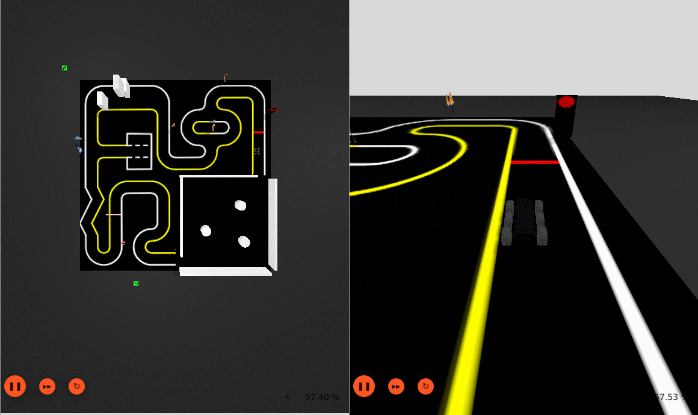

# Rover Simülasyonu (ArduPilot SITL + Gazebo Harmonic + ROS 2 Humble)

Docker içinde çalışan, ArduPilot **Rover** yazılımını (SITL) Gazebo Harmonic fizik simülasyonuna
bağlayan, temiz bir rover simülasyon paketi. Araç: ArduPilot `SITL_Models` içindeki **wildthumper**
skid-steer rover (lidarsız; modelde 6 tekerlek vardır). Dünyalar: varsayılan engelsiz düz pist (`rover_pist`) ve isteğe bağlı TurtleBot3 AutoRace pisti (`autorace`).

Hedef: Ubuntu + NVIDIA GPU. Bu pakette engel kaçınma, SLAM, lidar, raporlama veya görselleştirme kodu yoktur.

## Gereksinimler

- Ubuntu 22.04 veya 24.04 (grafik oturumu, X11)
- NVIDIA sürücüsü (`nvidia-smi` çalışmalı)
- Docker Engine + Docker Compose v2 (`docker compose`), kullanıcı `docker` grubunda
- NVIDIA Container Toolkit
- En az **15 GB boş disk**, rahat kurulum için **20 GB** önerilir. Ölçüm (küçültülmüş Dockerfile): bitmiş imaj **8,3 GB** (bunun 4,8 GB'ı temel `osrf/ros:humble-desktop`, 2,9 GB'ı Gazebo Harmonic); derleme sırasında geçici ek ~6 GB. İlk derleme bu makinede (20 çekirdek, hızlı ağ) ~25-35 dk sürdü; yavaş makinede/ağda daha uzun.

Kurulum komutları (yoksa):

```bash
# Docker: https://docs.docker.com/engine/install/ubuntu/ adımlarını izleyin, sonra:
sudo usermod -aG docker $USER      # sonra oturumu kapatıp açın

# NVIDIA Container Toolkit (önce https://nvidia.github.io/libnvidia-container deposunu ekleyin):
# https://docs.nvidia.com/datacenter/cloud-native/container-toolkit/latest/install-guide.html
sudo apt-get install -y nvidia-container-toolkit
sudo nvidia-ctk runtime configure --runtime=docker
sudo systemctl restart docker
```

## Kurulum

```bash
./kurulum.sh     # ön kontroller + docker compose build (imaj ~8,3 GB, ~25-35 dk)
```

`kurulum.sh` eksik olanı açıkça söyler ve çıkar. Derleme tamamlanınca imaj `rover_sim:latest` olur.

## Çalıştırma (3 terminal)

```bash
./baslat.sh      # container'ı başlatır (bir kez)

# Terminal 1
./sitl.sh        # ArduPilot Rover SITL + micro-ROS ajanı + MAVProxy çıkışları
# Terminal 2 (SITL'den birkaç sn sonra)
./gazebo.sh      # Gazebo (pencere) + rover + ROS köprüsü. Penceresiz: ./gazebo.sh gui:=false
# Terminal 3
./mavproxy.sh    # MAVProxy konsolu + harita
```

### Dünya seçimi

```bash
./gazebo.sh                  # varsayılan: düz, engelsiz pist (rover_pist.sdf)
./gazebo.sh world:=autorace  # TurtleBot3 AutoRace pisti (worlds/autorace/)
./gazebo.sh world:=autorace gui:=false
```



AutoRace dünyası **ROBOTIS** `turtlebot3_simulations` deposundan (Apache-2.0, dal `feature-gazebo-sim-migration`,
commit `970a3d0`) alınıp Gazebo Harmonic'e uyarlanmıştır; atıf, lisans ve değişiklik listesi:
`rover_sim/worlds/autorace/{LICENSE,KAYNAK.md}`. İki dünyanın SDF adı da `rover_pist`tir, bu yüzden
`config/bridge.yaml` ortaktır. Rover pistte şeritle hizalı, kırmızı başlangıç çizgisinin önünde `(1.5, -5.1)` konumunda doğar.

Bilinen eksikler / sınırlar (AutoRace):
- Trafik ışığı ve bariyer **eklentileri kaldırıldı**: ışık sürekli kırmızı, bariyer kolu sabit (orijinal Classic eklentileri Harmonic'te çalışmaz).
- Tüm işaretler ve engeller `static` (çarpınca devrilmez).
- Pist rover için **3x ölçeklidir** (orijinal 4x4 m -> 12x12 m; dış siyah zemin 30x30 m): şerit (sarı-beyaz çizgi eksenleri arası) ~0,9 m, çizgi kalınlığı dahil temiz genişlik ~0,8 m;
  rover (~0,35 m gövde, tekerlekler dahil görüntüde ~0,5 m) şeride sığar (şerit ~1,8-2,3x rover genişliği). Ölçekleme `rover_sim/worlds/autorace/olcekle.py` ile `orijinal/` (1x) dosyalardan üretilir; `autorace.sdf` ve `models/*/model.sdf` elle düzenlenmez.
- Doku çözünürlükleri düşüktür (pist dokusu 520x496 px).

İlk açılış yavaş olabilir (modeller yüklenir, EKF/GPS hazır olana kadar ~30 sn bekleyin).

## Aracı sürme

MAVProxy konsolunda:

```
mode manual
arm throttle
rc 3 1700        # gaz (ileri)
rc 1 1600        # direksiyon (sağa)
rc 3 1500        # dur
rc 1 1500
disarm
```

`rc N 0` ilgili override'ı bırakır. Arm reddedilirse (ön kontroller): `param set ARMING_SKIPCHK -1`
(SADECE simülasyonda). Kumanda yoksa yukarıdaki `rc` komutları yeterlidir; ROS tarafında `/odometry`,
`/imu`, `/navsat`, `/tf` konularını `ros2 topic echo` ile izleyebilirsiniz
(`docker exec -it rover_sim bash`).

## GPU erişimi (compose) ve test durumu

`docker-compose.yml` GPU'yu `deploy.resources.reservations.devices` (driver nvidia) ile ister. Bu anahtar
hem klasik nvidia runtime'da hem CDI tabanlı kurulumda çalışır; bu makinede (Toolkit 1.20, `docker info`
runtimes yalnızca runc, CDI etkin) `docker exec rover_sim nvidia-smi` GPU'yu gösterdi, ayrı bir değişiklik gerekmedi.

Gerçekten test edilenler (bu makinede, Ubuntu + RTX 4060 Laptop, sürücü 610.57): sıfırdan imaj derleme, duman testi
(yeni imajla GEÇTİ: kayma 0.000 m, 4.86 m ileri, roll 0°), `./sitl.sh` + `./gazebo.sh` (GUI) birlikte çalışma,
`gz sim -g` sürecinin NVIDIA GPU'da (G, ~376 MiB) görünmesi, günlükte nouveau/drawable hatası olmaması,
MAVProxy heartbeat (`Detected vehicle 1:1`), `kurulum.sh` ön kontrolleri, nogpu compose dosyasının `config` doğrulaması.
AutoRace dünyası (`world:=autorace`): GUI'siz yükleme hatasız, 3x ölçekli pistte duman testi GEÇTİ (kayma 0.0001 m, 4.86 m ileri, roll 0.03°; rover_pist regresyonu da GEÇTİ), Xvfb altında Gazebo GUI ekran görüntüsü alındı (`onizleme.png`).
**Test EDİLMEYENLER:** AutoRace'te GPU'lu (NVIDIA) GUI render'ı (görüntü yazılım render ile alındı); trafik ışığı/bariyer animasyonu (kaldırıldı); Gazebo penceresinin ekran görüntüsü (pencere başka pencerenin arkasındaydı, görüntü alınamadı);
nogpu yolunun çalıştırılması (yalnızca `docker compose config` geçerli); başka bir makinede kurulum; Ubuntu 24.04 ve 22.04 dışı sürümler.

## Duman testi

```bash
docker exec -it rover_sim bash -c '~/test/duman_testi.sh'            # rover_pist (varsayılan)
docker exec -it rover_sim bash -c '~/test/duman_testi.sh autorace'    # AutoRace dünyası
```

GUI'siz SITL+Gazebo başlatır, MANUAL+arm yapıp 10 sn sürer; açılış kayması, ilerleme ve roll
sınırlarını kontrol eder, GEÇTİ/KALDI yazar (çıkış kodu 0/1) ve her şeyi durdurur.

## Durdurma

```bash
./durdur.sh            # simülasyon süreçlerini durdurur
./durdur.sh --kapat    # ayrıca container'ı da kaldırır
```

## GPU'suz makine

```bash
COMPOSE_FILE=docker-compose.nogpu.yml ./baslat.sh
```
(Yazılım render, yavaştır; imajı yine `docker compose -f docker-compose.nogpu.yml build` ile derleyebilirsiniz.)

## Sık sorunlar

- **`ardupilot_sitl` derlemesi 'you need to install pexpect' ile düşüyor:** Dockerfile'daki pip satırı (pexpect, future, lxml, dronecan, empy==3.3.4) olmadan olur; rosdep bu paketleri getirmez.
- **`rosdep ... Cannot locate rosdep definition for [gz-sim8]` uyarısı:** zararsızdır; Gazebo `gz-harmonic` ile zaten kuruludur.
- **`./sitl.sh` 'cannot attach stdin to a TTY':** betikler etkileşimli terminal ister; arka planda çalıştıracaksanız `script -qfc ./sitl.sh /dev/null` kullanın.
- **Gazebo penceresi açılmıyor / `cannot open display`:** `xhost +local:` çalıştırın (`baslat.sh` yapar); `echo $DISPLAY` boş olmamalı.
- **GPU görünmüyor / `could not select device driver "nvidia"`:** NVIDIA Container Toolkit kurulu mu, `docker info | grep -i nvidia`. Olmazsa nogpu yedeği.
- **Port 5760 dolu / SITL bağlanmıyor:** `./durdur.sh` ile eski süreçleri temizleyin ve yeniden başlatın.
- **Gazebo siyah ekran:** ilk açılışta 30-60 sn bekleyin; sürmezse GPU ayarlarını ve `LIBGL_ALWAYS_SOFTWARE=1` yedeğini deneyin.
- **Rover arm olmuyor:** EKF hazır olmayabilir; ~30 sn bekleyin ya da simülasyonda `param set ARMING_SKIPCHK -1`.
- **Parametre değişikliği etkisiz:** SITL parametreleri çalışma dizinindeki `eeprom.bin` dosyasında kalıcıdır; silip yeniden başlatın.

## Dosya yapısı

```
Dockerfile, docker-compose.yml, docker-compose.nogpu.yml
kurulum.sh baslat.sh sitl.sh gazebo.sh mavproxy.sh durdur.sh   # host betikleri
rover_sim/                       # container içinde ~/rover_sim olarak bağlanır
  launch/{sitl,gazebo,rover}.launch.py
  worlds/rover_pist.sdf          # düz pist (zemin mu=1.0)
  worlds/autorace/               # TurtleBot3 AutoRace (autorace.sdf, models/, LICENSE, KAYNAK.md, onizleme.png)
  config/{bridge.yaml,rover_sim.parm}
  patches/ArduPilotPlugin_pwm0.patch
  run_sitl.sh run_gazebo.sh stop.sh
test/duman_testi.{sh,py}
AGENT.md                         # yapay zekâ ajanı için kurulum rehberi
```

## Sabitlenen sürümler

| Bileşen | Commit |
|---|---|
| ardupilot (ArduPilot/ardupilot) | ccdfd945aefb19503f1d5687800c691e096b9d26 |
| ardupilot_gazebo (Jagadeesh-pradhani) | 7276c750cdb7393c620880d996ce73ca4d916c11 |
| ardupilot_gz (Jagadeesh-pradhani) | 9f6742b9467eafd6747ced71d6e766205489cf1e |
| ardupilot_sitl_models (ArduPilot/SITL_Models) | d5d6017367a509b77886379c91207edc66f77652 |
| micro_ros_agent (micro-ROS-Agent) | c93ee764e0d2ef4907aeb29233c68cb5f4b56976 |
| ros_gz (gazebosim) | 28e586a3d41f80f4a91e81902b8618c9d506022c |
| sdformat_urdf (ros) | 7b73ddb8af07b8dd5cee5fa8231e982f4ad8c217 |
| Micro-XRCE-DDS-Gen (ardupilot) | 4bc7ec2c7f77ae89cd216432f05470ad99f7faa1 |

Gazebo: gz-harmonic (packages.osrfoundation.org). Taban imaj: osrf/ros:humble-desktop.

## Lisans

`rover_sim/worlds/autorace/` altındaki dünya ve modeller ROBOTIS-GIT/turtlebot3_simulations'tan türetilmiştir
(Apache-2.0; `rover_sim/worlds/autorace/LICENSE`, değişiklikler `KAYNAK.md`).

Bu depodaki kendi betik ve yapılandırmalarımız **MIT** lisanslıdır (`LICENSE`). İmaj içinde derlenen
alt projeler (ArduPilot GPLv3, ardupilot_gazebo, ros_gz, vb.) kendi lisanslarıyla dağıtılır; bu
depo onları içermez, yalnızca derleme sırasında indirir. `ArduPilotPlugin_pwm0.patch`,
ardupilot_gazebo'nun lisansına (LGPL-3.0) tabidir.

## Güvenlik notu
`baslat.sh`, Gazebo penceresinin açılabilmesi için `xhost +local:` çalıştırır: bu, bu bilgisayardaki yerel kullanıcıların/container'ların X ekranınıza erişmesine izin verir. İş bitince isterseniz `xhost -local:` ile geri alabilirsiniz.
